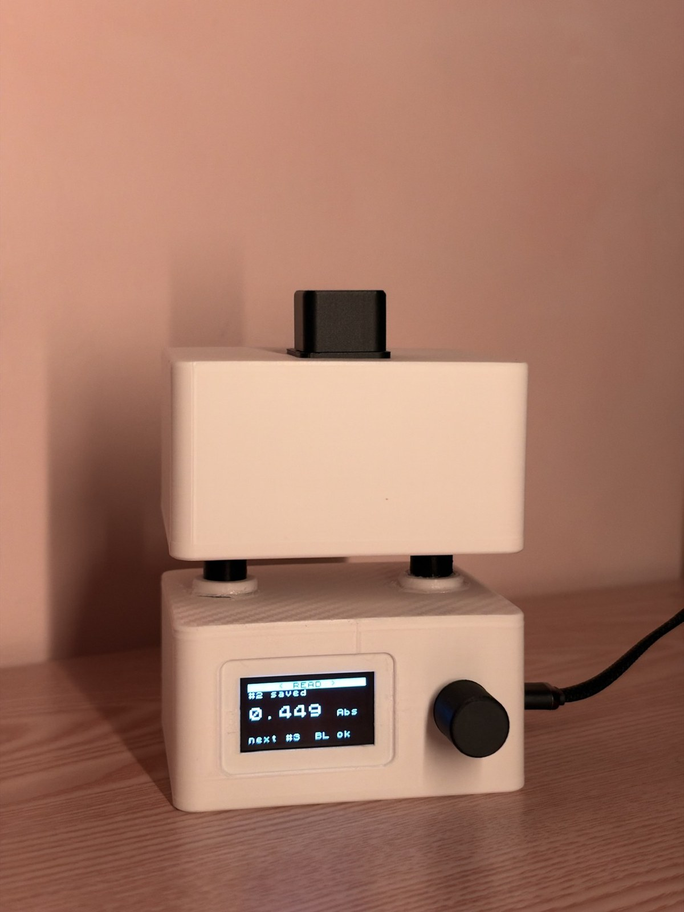
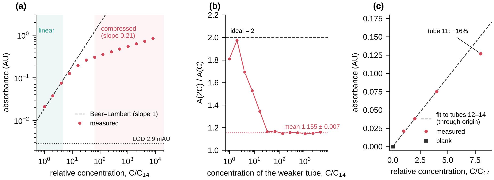
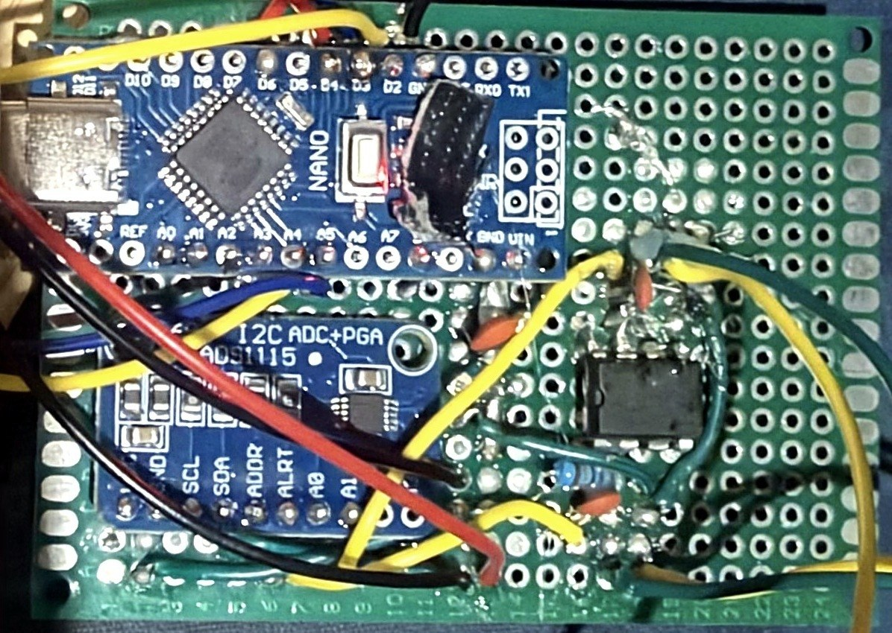
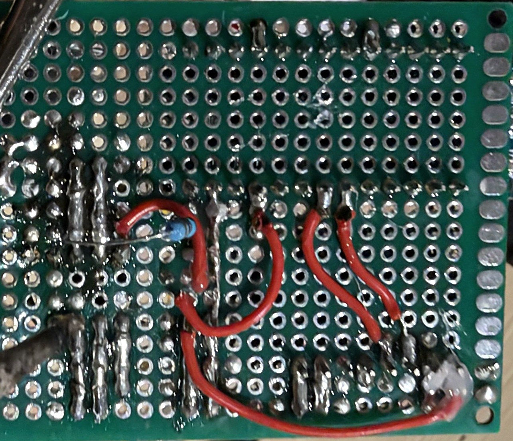

# OpenBench CM1

by **Taha Rafi**

An open-source, 3D-printed double-beam LED colorimeter that costs about **£13** in parts, with firmware that measures and calibrates each copy of the instrument by itself.

**Preprint and project site:** [openbench.oesimracing.com](https://openbench.oesimracing.com)

## What it does

- **Double-beam measurement.** A second photodiode watches the LED, so the absorbance is a ratio that cancels LED drift. Measured drift: 0.2 mAU/h with the ratio, against 9.1 mAU/h single-beam.
- **Precision.** 0.89 mAU per reading (1 SD), with a limit of detection of 2.9 mAU. Each reading switches the LED on and off and subtracts the difference, which rejects ambient light.
- **Standalone.** It runs on an Arduino Nano with a 1.3" OLED and one control knob: turn, press or hold. It streams CSV over USB.
- **Self-characterisation (optional).** A 34-minute routine measures your unit's noise, drift, settling time and gain matching. The main firmware then loads those results automatically; without it, the firmware uses the reference unit's calibration.

## Key finding: spectral bandwidth limits the linear range, not noise

A two-fold dilution series of a blue food dye (E133), spanning an 8,192-fold concentration range, gave three results:

- **Beer–Lambert holds only below about 0.09 AU.** Above that, each two-fold dilution changes the reading by a constant factor of 1.155, not 2.
- **Stray light is not the cause.** It was measured at below 0.004%.
- **The cause is the detected band of light.** The white LED, the red gel and a silicon photodiode that still responds in the near-infrared together cover a band wider than the dye's absorption band.

The **two-fold ratio test** needs no standards of known concentration. Make a stock solution, halve it repeatedly and read each step. A Beer–Lambert instrument gives a ratio of 2 between neighbouring steps, and wherever the ratio drops below 2 your linear range has ended. Try it on your own colorimeter.

## Repository contents

| Folder | Contents | Licence |
|---|---|---|
| `hardware/` | Print-ready parts (3MF, already oriented) with parts list and assembly guide | CERN-OHL-S-2.0 |
| `firmware/colorimeter_ui/` | Main instrument firmware | GPL-3.0 |
| `firmware/pd_align/` | One-time photodiode alignment tool | GPL-3.0 |
| `firmware/pd_characterise/` | Optional one-time 34-minute self-characterisation | GPL-3.0 |
| `data/` | Characterisation summary (15 Nov 2026) and dilution series (17 Nov 2026) | CC BY 4.0 |
| `docs/` | Schematic, bill of materials, photos | CC BY 4.0 |

## Build

1. **Print and assemble** the parts in `hardware/`, following [its guide](hardware/README.md). The optical core and light-trap parts must be opaque black PLA, because white PLA lets enough light through to swamp the photocurrents.
2. **Solder** the control board following [the schematic](docs/img/schematic.png) and the [bill of materials](docs/BOM.csv). Each photodiode's cathode goes to its op-amp's inverting input. A reversed photodiode gives a small, logarithmic response.

    

3. **Install the software.** In the Arduino IDE, install the **U8g2** library and select **Arduino Nano, ATmega328P (Old Bootloader)**. Use the plain ATmega328P setting if your Nano has the new bootloader.
4. **Flash `pd_align`.** Move each photodiode until the screen shows close to 100%, then glue it in place.
5. **Flash `colorimeter_ui`.** It works straight away with the reference unit's calibration, and the start screen shows **"std cal"**.
6. **Optional: calibrate your own unit.** Flash `pd_characterise` and leave the instrument for about 34 minutes, with the cuvette slot empty, the gel in and the lid on. Then flash `colorimeter_ui` again. It finds the results in EEPROM and uses your unit's own gain-matching factors and settling time, and the start screen shows **"own cal"**.

   The results are also printed over USB at 115200 baud. Open the Serial Monitor **before** you start, because opening it resets the Nano.

## Use

1. Power it from USB; a power bank works.
2. After the 30-second warm-up, insert a cuvette of solvent with its clear faces in the beam, and press to blank.
3. Insert the sample and choose **READ**.

**For concentrations:** add standards with **+STD**, then choose **FIT CURVE**. With the white LED and red gel, keep the standards below about 0.09 AU, because the fit is a straight line.

## Licences

- **Hardware:** [CERN-OHL-S-2.0](LICENSES/CERN-OHL-S-2.0.txt)
- **Firmware:** [GPL-3.0](LICENSES/GPL-3.0-only.txt)
- **Data and documentation:** [CC BY 4.0](LICENSES/CC-BY-4.0.txt)

## Citation

T. Rafi, *OpenBench CM1: an open-source double-beam LED colorimeter, and a calibration-free dilution test showing that spectral bandwidth, not noise, limits its linear range*, preprint, 2026. https://openbench.oesimracing.com

